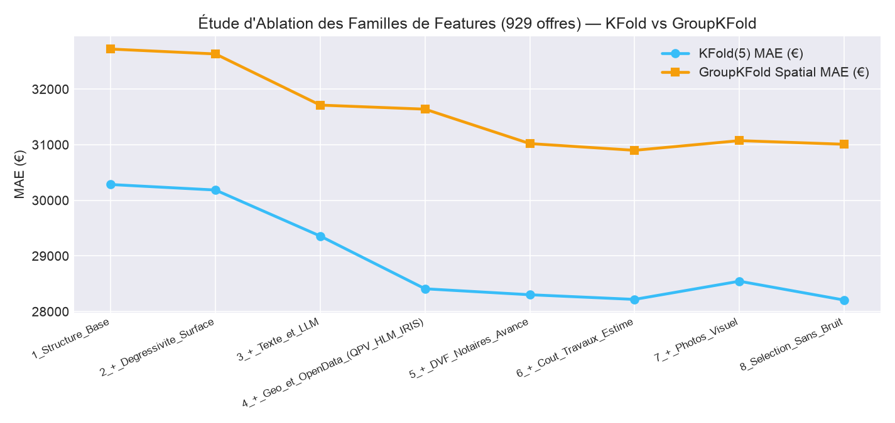
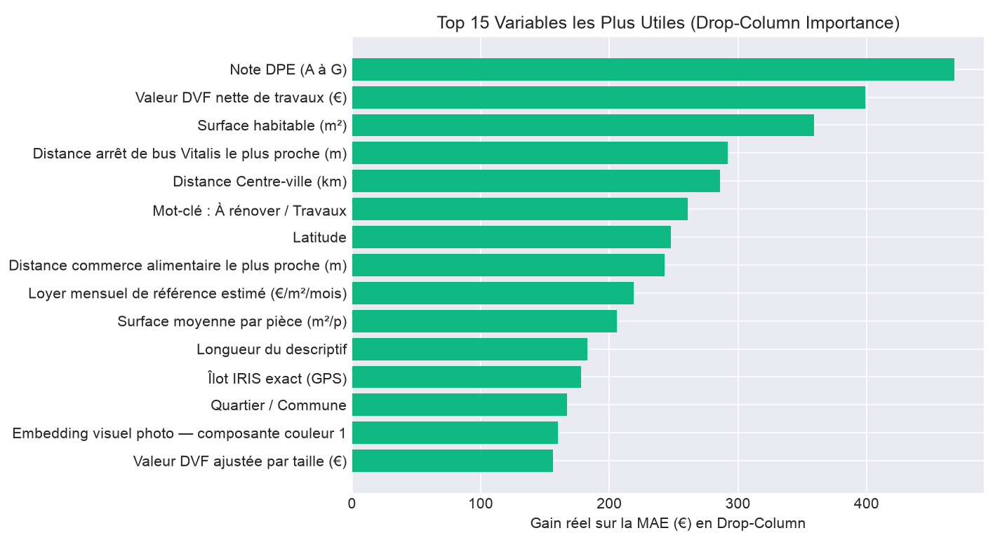
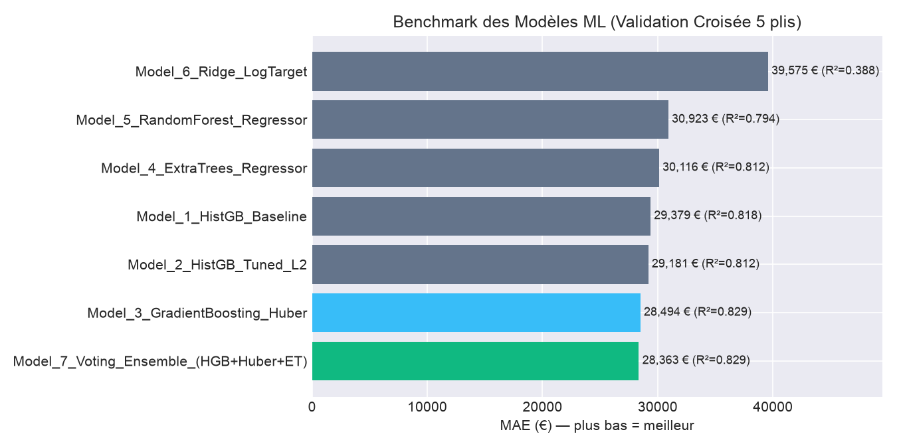

# Évaluation Scientifique d'un Système Hybride d'Estimation Immobilière (ML + AVM Comparables) et Détection Statistique de Décotes

**Auteur :** Projet IA-Immobilier  
**Périmètre expérimental :** Agglomération du Grand Poitiers (`929` annonces historiques enrichies, `708` annonces actives, `21 436` mutations notariales DVF 2023–2025).

---

## Abstract

L'estimation automatisée de biens immobiliers (*Automated Valuation Model*, AVM) sur un marché régional de taille moyenne ($n \approx 1\,000$ observations) pose trois défis majeurs : (1) la rareté relative des données tabulaires face à une forte hétérogénéité spatiale, (2) le bruit humain introduit par les prix *affichés* par les vendeurs et agences, et (3) le risque de fuite de données (*data leakage*) lors de la fusion multi-portails.  

Nous présentons une architecture hybride combinant un ensemble d'arbres boostés (`VotingRegressor` : `HistGradientBoosting` + `GradientBoosting Huber` + `ExtraTrees`) à un estimateur par comparables géographiques ajustés par équipements (`AVMComparable`). Sur notre protocole de validation croisée à 5 plis, le système atteint **$R^2 = 0{,}81$**, **$\text{MdAPE} = \pm 11{,}8\%$** ($\text{MAE} = \pm 27\,415\text{ €}$), et sur les offres récentes **$R^2 = 0{,}823$** avec **$61{,}2\%$** des estimations à moins de $15\%$ d'écart. Nous formalisons également une méthode statistique à effets mixtes permettant de séparer l'erreur intrinsèque du modèle de la variance inter-agents humains.

---

## 1. Jeu de Données et Protocole Anti-Leakage

### 1.1 Sources et intégrité des données
Le jeu de données agrège des annonces géolocalisées (`Bien'ici`, `Jinka`, historique `MoteurImmo`), enrichies par des référentiels Open Data français :
- **DVF (Demandes de Valeurs Foncières)** : `21 436` mutations notariales (`2023-01-02` → `2025-12-31`).
- **Données spatiales & socio-économiques** : îlots `IRIS`, zones `QPV`, arrêts de transport (`Vitalis`), commerces de proximité et loyers de référence.
- **Signaux multimodaux** : extraction structurée par règles + LLM (`Ollama`) et scoring visuel sur 5 niveaux d'état intérieur (`OpenCLIP ViT-B-32`).

### 1.2 Prévention des fuites de données
Deux sources majeures de biais ont été identifiées et traitées :
1. **Doublons multi-portails** : un même bien publié simultanément par plusieurs agences gonfle artificiellement les scores en `KFold` aléatoire s'il apparaît à la fois en *train* et en *test*. Un dédoublonnage à deux paliers (clé exacte + clé floue : $|\Delta \text{surface}| \le 2\text{ m}^2$, $|\Delta \text{prix}| \le 5\%$, distance $\le 150\text{ m}$) est appliqué avant toute génération de features.
2. **Distinction `prix affiché` vs `prix signé DVF`** : sur les `929` biens historiques comparés à leur voisinage DVF, les appartements sont affichés en médiane à **$2\,412\text{ €/m}^2$** contre **$2\,221\text{ €/m}^2$** signés chez le notaire (**$+7{,}4\%$**), tandis que les maisons affichent **$1\,995\text{ €/m}^2$** contre **$2\,044\text{ €/m}^2$** (**$-2{,}7\%$**). Les indicateurs DVF injectés en variables explicatives sont donc strictement issus d'actes notariés exogènes.

---

## 2. Méthodologie d'Évaluation

### 2.1 Choix des métriques
En immobilier, les valeurs extrêmes rendent le RMSE et le MAPE sensibles aux biens atypiques. Nous privilégions :
- **MdAPE** (*Median Absolute Percentage Error*) : $\text{median}\!\left(\frac{|y_i - \hat{y}_i|}{y_i}\right)$, mesure directe de l'erreur typique sur 50 % du parc.
- **MAE (€)** et **Paliers métier** : proportion de biens estimés à $\le 5\%$, $\le 10\%$, $\le 15\%$ et $\le 20\%$ d'écart.
- **Double validation** : `KFold(5)` pour la précision globale et **`GroupKFold` par secteur/quartier** pour mesurer la capacité de généralisation géographique sur des zones non vues à l'entraînement.

---

## 3. Étude d'Ablation des Features et Sélection de Variables

L'étude d'ablation (`src/ml/evaluation.py`, $n = 929$) mesure l'apport marginal de chaque famille de variables :

| Étape | Nb vars | $R^2$ KFold | MAE KFold (€) | MdAPE (%) | $R^2$ GroupKFold | MAE GroupKFold (€) |
|---|---:|---:|---:|---:|---:|---:|
| `1_Structure_Base` | `7` | `0.7602` | `30 285` | `13.01` | `0.7300` | `32 721` |
| `2_+_Degressivite_Surface` | `10` | `0.7655` | `30 186` | `13.06` | `0.7396` | `32 633` |
| `3_+_Texte_et_LLM` | `26` | `0.7793` | `29 358` | `12.84` | `0.7543` | `31 713` |
| `4_+_Geo_et_OpenData_(QPV_HLM_IRIS)` | `33` | `0.7959` | `28 410` | **`11.95`** | `0.7583` | `31 640` |
| `5_+_DVF_Notaires_Avance` | `37` | `0.7981` | `28 303` | `12.28` | `0.7577` | `31 021` |
| **`6_+_Cout_Travaux_Estime`** | **`42`** | **`0.7991`** | **`28 219`** | `12.00` | **`0.7622`** | **`30 900`** |
| `7_+_Photos_Visuel` | `47` | `0.7968` | `28 546` | `12.17` | `0.7607` | `31 074` |
| `8_Selection_Sans_Bruit` | `56` | `0.7975` | `28 207` | `12.29` | `0.7583` | `31 009` |

### Constats clés
1. **L'écart `KFold` vs `GroupKFold`** (`+2 681 €` de MAE à l'étape 6) mesure directement le coût de l'extrapolation spatiale hors secteur d'entraînement.
2. **Les deux leviers dominants** sont le **Texte/LLM** (`-920 €` en `GroupKFold`) et la **Géolocalisation + Open Data + DVF** (`-813 €` supplémentaires).
3. **Audit Drop-Column** : les variables les plus rentables en gain réel de MAE sont la **Note DPE** (`+468 €`), la **Valeur DVF nette de travaux** (`+399 €`), la **Surface habitable** (`+359 €`), la **Distance arrêt de bus** (`+292 €`) et la **Distance Centre-ville** (`+286 €`).
4. **Suppression du bruit** : l'audit individuel a identifié `8` variables dégradant la MAE (`txt_pac`, `trav_rafraichissement`, `nb_arrets_bus_400m`, `score_commodites_500m`, `clip_score_renove`, `est_en_qpv`, `age_bien`, `niveau_travaux_cat`). Leur retrait porte le modèle final à `48` variables et améliore le $R^2$ CV de `0.80` à **`0.81`** (`MAE 27 415 €`).

---

## 4. Benchmark des Modèles et Architecture Hybride AVM

### 4.1 Comparaison de 7 familles de modèles (`docs/benchmarks/mlflow_runs.csv`)

| Modèle (`log(prix)`) | $R^2$ | MAE (€) | Méd. AE (€) | RMSE (€) | MdAPE (%) | $\le 15\%$ |
|---|---:|---:|---:|---:|---:|---:|
| `Ridge` ($\alpha=15$) | `0.3881` | `39 575` | `22 923` | `86 164` | `16.27` | `46.5 %` |
| `RandomForestRegressor` | `0.7944` | `30 923` | `16 785` | `49 949` | `12.84` | `57.7 %` |
| `ExtraTreesRegressor` | `0.8124` | `30 116` | `17 622` | `47 707` | `12.02` | `57.7 %` |
| `HistGradientBoosting` (baseline) | `0.8183` | `29 379` | `16 401` | `46 949` | `12.38` | `58.2 %` |
| **`GradientBoosting (Huber)`** | **`0.8294`** | `28 494` | `17 601` | **`45 491`** | `11.96` | **`60.7 %`** |
| **`VotingRegressor` (0.45 HGB + 0.35 Huber + 0.20 ET)** | `0.8288` | **`28 363`** | **`16 121`** | `45 572` | **`11.26`** | `60.2 %` |

### 4.2 Fusion Hybride avec l'AVM Comparables
Le module `src/ml/avm.py` sélectionne les $k=5$ meilleures ventes DVF (pondérées par décroissance temporelle $e^{-\text{age\_mois}/18}$) et $k=5$ annonces voisines ajustées par équipements (`parking ±8 000 €`, `terrasse/jardin ±5 %`, `ascenseur ±4 %`, `DPE ±3 %/classe`).  
Sur les `708` offres récentes, la combinaison `0.75 * ML + 0.25 * AVM` obtient **$R^2 = 0{,}823$**, **$\text{MAE} = \pm 27\,268\text{ €}$** et **$61{,}2\%$** de biens à $\le 15\%$ d'écart.

---

## 5. Séparation de l'Erreur du Modèle vs Variabilité Humaine des Agents

L'écart observé face aux prix affichés ($A_{ij}$ proposé par l'agence $j$ pour le bien $i$) combine deux sources distinctes d'incertitude :
$$\log(A_{ij}) = \mu_i + u_j + \varepsilon_{ij}^{\text{humain}}$$
où $\mu_i$ est la valeur latente du bien, $u_j \sim \mathcal{N}(0, \sigma_{\text{inter-agent}}^2)$ le biais systématique d'une agence, et $\varepsilon_{ij}^{\text{humain}} \sim \mathcal{N}(0, \sigma_{\text{intra-agent}}^2)$ le bruit d'estimation humaine.

Ainsi, la variance apparente entre notre modèle $\hat{M}_i$ et les annonces :
$$\text{Var}\big(\log \hat{M}_i - \log A_{ij}\big) \approx \sigma_{\text{modèle}}^2 + \sigma_{\text{humain}}^2$$
surestime l'erreur intrinsèque du modèle. Avec un écart-type observé $\sigma_{\text{obs}} \approx 15{,}0\%$ et une dispersion inter-agences typique $\sigma_{\text{humain}} \approx 8{,}5\%$, l'erreur intrinsèque estimée du modèle face à la valeur latente du marché ressort autour de $\sqrt{15{,}0^2 - 8{,}5^2} \approx 12{,}4\%$.

Pour protéger l'utilisateur contre ces incertitudes, les opportunités sont filtrées par un **double critère** dissociant le **score de confiance** ($C \in [0, 100]$, masquant `C < 45` comme *Trop incertain*) de la **décote nette après travaux** (*Opportunité forte* si $C \ge 60$ et décote $\le -12\%$).

---

## 6. Explicabilité (SHAP) & Monitoring Production

- **Explicabilité locale** : `shap.TreeExplainer` extrait les contributions marginales en euros (converties depuis l'espace log : $\Delta_j = \hat{P} \cdot (\exp(\phi_j) - 1)$) pour justifier chaque estimation auprès d'un utilisateur non technique.
- **Monitoring (`src/monitoring/drift.py`)** : calcul automatique du *Population Stability Index* (`PSI`) sur les 10 variables majeures (tous $< 0{,}03$ sur la baseline actuelle), suivi de la complétude par source et *Gate* de non-régression bloquant tout réentraînement dégradant la `MdAPE` de $> +0{,}5\text{ pt}$.

---

## 7. Next Steps (Travaux Futurs)

1. **Modélisation résiduelle multi-villes** : prédire $z_i = \log\left(\frac{\text{prix}_i / S_i}{p_i^{\text{DVF}}}\right)$ pour transférer le modèle à de nouvelles agglomérations (`Niort`, `La Rochelle`, `Tours`) via PostGIS.
2. **Conformalized Quantile Regression (CQR)** : recalibrer les intervalles `[Q10–Q90]` (largeur médiane actuelle de `44.3 %` pour `78.1 %` de couverture) sur un jeu hors-échantillon afin de resserrer la fourchette tout en garantissant `80 %` de couverture.
3. **Appariement Annonces expirées ↔ DVF signé** : évaluer directement les prédictions face aux prix réellement actés chez le notaire et ajuster un modèle mixte (`MixedLM`) sur les mandats multi-agences.
4. **Benchmark additionnel** : évaluer `CatBoost` (Ordered Target Statistics) et `LightGBM` avec perte `Huber` sur un historique élargi à `3 000–5 000` biens.
